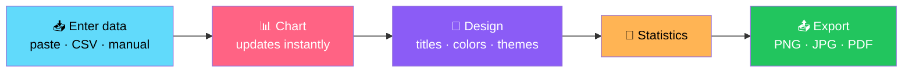
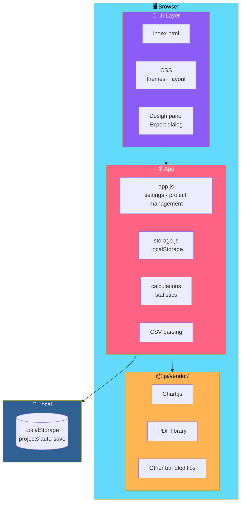

# 📊 ChartCraft Studio

<div align="center">


**Enter numbers. Get charts, statistics, and exports.**

*A browser-based chart generator — no backend, no database, no API keys.*

[🚀 Run](#-run) • [🎨 Features](#-features) • [🏗️ Architecture](#️-architecture) • [🧪 Tests](#-tests) • [🔧 Troubleshooting](#-troubleshooting)

</div>

---

## 📖 Overview

**ChartCraft Studio** is a **browser-based chart generator**.

Enter numbers → get **charts**, **statistics**, and **PNG / JPG / PDF exports**.

### Core Idea

> **No backend. No database. No API keys.**
>
> Libraries are **bundled in `js/vendor/`** — so it **works offline**.

### The Flow



---

## 🚀 Run

### 1. Extract

**Extract `ChartCraft-Studio.zip`.**

### 2. Open

**Open the folder in VS Code**, right-click `index.html`, choose **Open with Live Server**.

> 💡 **Opening `index.html` directly also works.**

---

## 🎨 Features

<div align="center">

| 📊 Live Charts | ✏️ Editable Table |
|:---:|:---:|
| Every change updates instantly | Add rows · add series · rename headers |
| **↩️ Undo / Redo** | **📋 Paste & Import** |
| `↶ ↷` buttons | Paste cells from Excel / Sheets · import CSV · **header row auto-detected** |
| **🎨 Design Panel** | **📤 Export Formats** |
| Titles · axes · palette · **per-segment colors** · theme · number format · legend · labels | **PNG** *(1–4×, transparent option)* · **JPG** *(quality)* · **PDF** *(A4 / A3 / Letter / custom)* |
| **📄 PDF Reports** | **🖼️ Export Preview** |
| Orientation · optional title/date/statistics/table · **multiple charts via "Add to PDF report"** | Shown in the dialog before you commit |
| **📁 Other Exports** | **💾 Projects** |
| CSV · config JSON · print · copy-to-clipboard | Auto-save to this browser's **LocalStorage** · use **Export JSON / Import JSON** to move between devices |

</div>

### 📊 Live Chart Editing

- **Pick a chart type**
- **Edit the table** — add rows and series, rename headers
- **Everything updates instantly**
- **Undo / redo** with the `↶ ↷` buttons

### 📋 Paste or Import

- **Paste cells directly from Excel or Sheets**
- **Import a CSV** — **a header row is detected automatically**
- **Examples are in `samples/`**

### 🎨 Design Panel

Full control over:

- **Titles**
- **Axes**
- **Palette**
- **Per-segment colors**
- **Theme**
- **Number format**
- **Legend**
- **Labels**
- and more

### 📤 Export

| Format | Options |
|--------|---------|
| **PNG** | **1× / 2× / 3× / 4×** resolution · **transparent** option |
| **JPG** | **Quality** control |
| **PDF** | **A4 / A3 / Letter / custom** · **orientation** · optional **title / date / statistics / table** · **multiple charts via "Add to PDF report"** |

Plus:

- **CSV** export
- **Config JSON** export
- **Print**
- **Copy to clipboard**

> 💡 **A preview is shown in the dialog** — so you see exactly what you'll get.

### 💾 Projects

> ⚠️ **Projects auto-save to this browser's LocalStorage and do not move between devices.**
>
> **Use *Export JSON / Import JSON* to move between devices.**

---

## 🏗️ Architecture

### System Overview



### Design Principles

<div align="center">

| Principle | Implementation |
|-----------|---------------|
| **🌐 Fully offline** | Libraries bundled in `js/vendor/` — no CDN calls at runtime |
| **🚫 No backend** | No server, no database, no API keys — the browser does everything |
| **⚡ Instant feedback** | Every edit updates the chart immediately |
| **↩️ Undo / redo** | Edits are reversible with the `↶ ↷` buttons |
| **📋 Excel-native input** | Paste directly from Excel or Sheets — no reformatting needed |
| **🧮 Statistics built in** | The app computes and displays statistics alongside the chart |
| **📤 Real exports** | PNG, JPG, PDF, CSV, JSON — plus print and clipboard |
| **📄 Multi-chart PDF reports** | Combine several charts into a single PDF via "Add to PDF report" |
| **💾 Local projects** | Auto-save to LocalStorage, portable via JSON export/import |
| **⚠️ Honest about limits** | Percentages show "unavailable" for negative or zero totals — by design |

</div>

---

## 🧪 Tests

```bash
node tests/calculations.test.js
```

**Requires Node 18+.**

### What's Covered

- **Calculation logic**
- **CSV parsing logic**

---

## 🔧 Troubleshooting

<div align="center">

| Problem | Solution |
|---------|---------|
| **Blank page** | Check the browser console — make sure `js/vendor/` files exist |
| **Clipboard copy doesn't work** | It needs **HTTPS or localhost** and browser permission |
| **Percentages show "unavailable"** | By design — shown when values are negative or total is zero |
| **Reset data** | Clear the site's **LocalStorage** in browser dev tools |

</div>

---

## 📝 Notes

> **Structure differs slightly from the brief:**
>
> **Settings and project management live in `app.js` / `storage.js`** rather than separate files.

---

## 🗺️ Roadmap

### ✅ Current

- [x] Multiple chart types with instant updates
- [x] Editable table — add rows, add series, rename headers
- [x] Undo / redo with `↶ ↷` buttons
- [x] Paste from Excel or Sheets
- [x] CSV import with automatic header detection
- [x] Example files in `samples/`
- [x] Design panel — titles, axes, palette, per-segment colors, theme, number format, legend, labels
- [x] Statistics computed and displayed
- [x] PNG export — 1–4× resolution and transparent option
- [x] JPG export with quality control
- [x] PDF export — A4 / A3 / Letter / custom, with orientation
- [x] PDF report options — title, date, statistics, table
- [x] Multi-chart PDF reports via "Add to PDF report"
- [x] Export preview dialog
- [x] CSV export
- [x] Config JSON export
- [x] Print support
- [x] Copy-to-clipboard
- [x] Project auto-save to LocalStorage
- [x] Export JSON / Import JSON for cross-device portability
- [x] All libraries bundled in `js/vendor/` — works offline
- [x] Node test suite for calculations and CSV parsing
- [x] Clear error behavior for negative or zero totals

### 🔜 Future Ideas

- [ ] **Additional chart types** — radar, heatmap, waterfall
- [ ] **Multiple export resolutions presets** — e.g. social media sizes
- [ ] **Chart templates** — save and apply design presets
- [ ] **Opt-in cloud sync** — for projects across devices
- [ ] **Data validation warnings** — before export
- [ ] **Formula support** in the table — computed columns
- [ ] **Localization** — bilingual UI
- [ ] **Accessibility improvements** — keyboard navigation, screen reader labels
- [ ] **Chart image embedding in PDF reports** — with captions
- [ ] **Import from `.xlsx`** — beyond CSV

---

## 🤝 Contributing

Contributions are welcome. Please:

1. Fork the repository
2. **Keep it offline-first** — everything runs without network access
3. **Keep the vendor libraries bundled** — no CDN calls at runtime
4. **Preserve instant updates** — every edit should update the chart immediately
5. **Keep undo / redo functional** — reversibility is a feature
6. **Never claim a percentage is available** when values are negative or the total is zero
7. **Keep LocalStorage as the project store** — no accounts, no backend
8. **Update the tests** when changing calculations or CSV parsing
9. Submit a Pull Request

### Guidelines

- **Never add a required backend** — the app must work from `file://` or any static server
- **Never remove undo / redo** — the editing model depends on it
- **Never break project JSON compatibility** without a migration path
- **Never ship the app without `js/vendor/`**
- **Never present a stub as a feature**

---

## 📜 License

MIT — see [LICENSE](LICENSE) for details.

---

## 🙏 Acknowledgments

- **Chart.js** — for making beautiful charts approachable
- **The PDF library** — for real exports without a server
- **Every analyst who's ever rebuilt the same spreadsheet chart for the tenth time** — this one's for you

---

<div align="center">

### 📊 ENTER. CHART. EXPORT.

**Enter numbers. Get charts, statistics, and exports.**

**No backend. No database. No API keys. Works offline.**

<br>

⭐ If ChartCraft helped you, consider giving it a star.

<br>

[⬆ Back to Top](#-chartcraft-studio)

</div>
